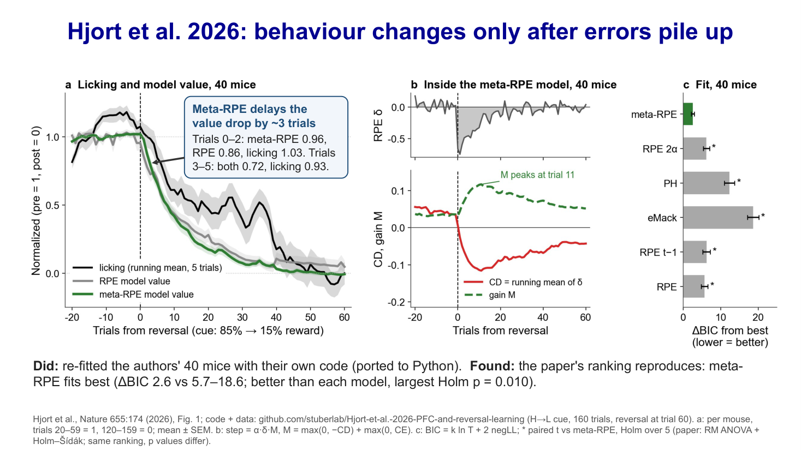
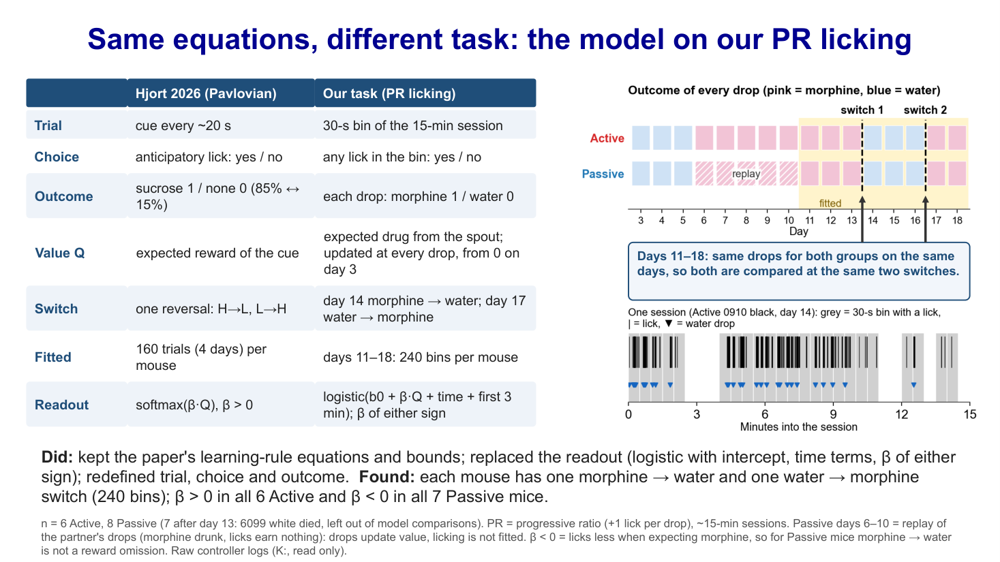
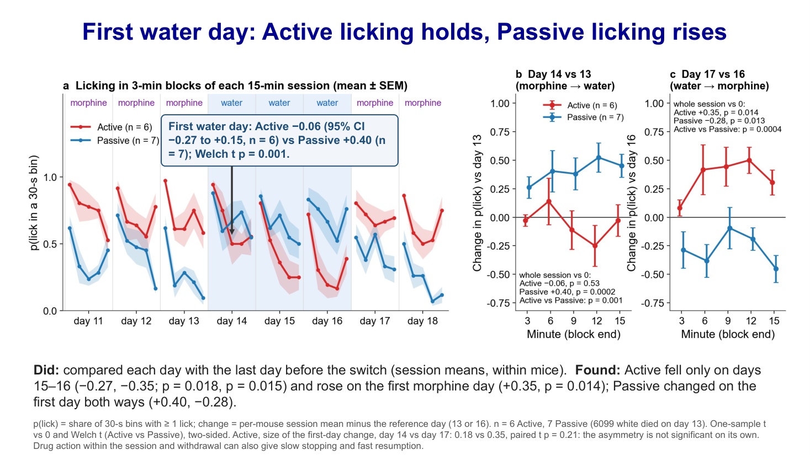
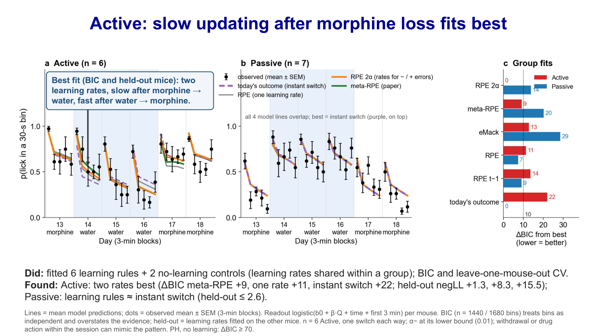
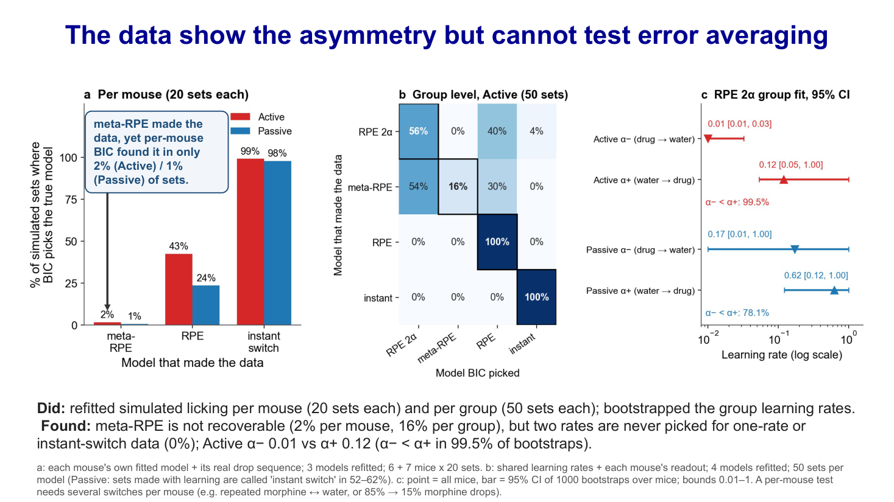
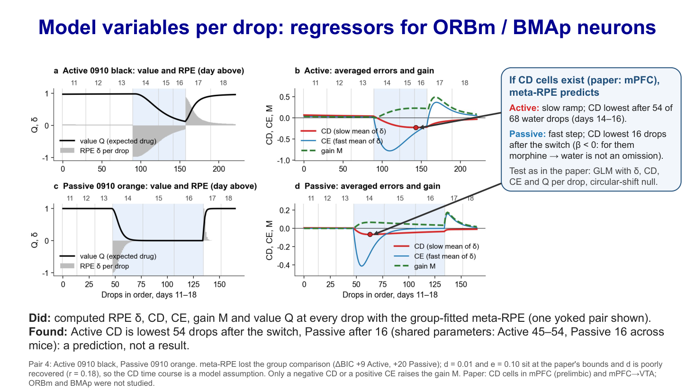
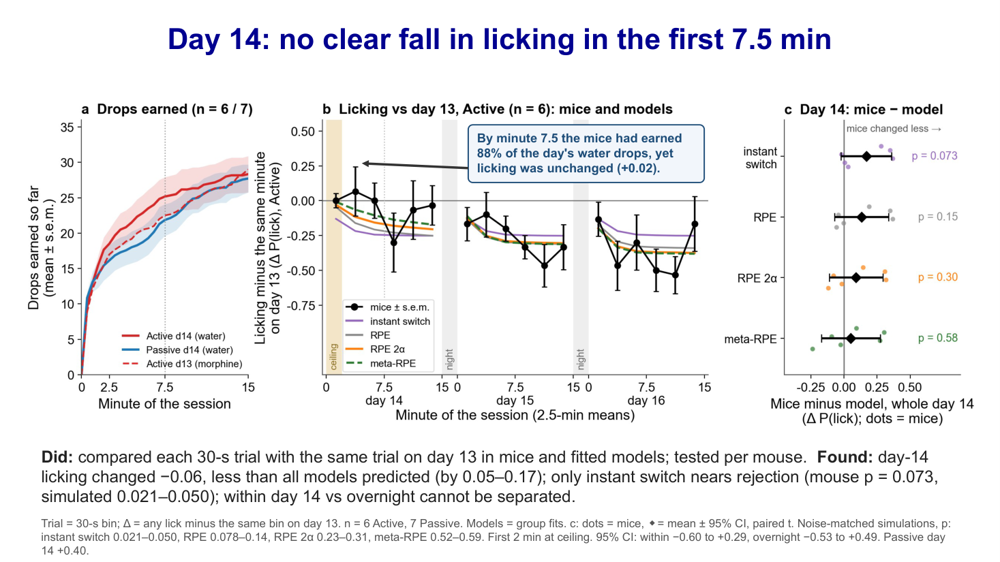
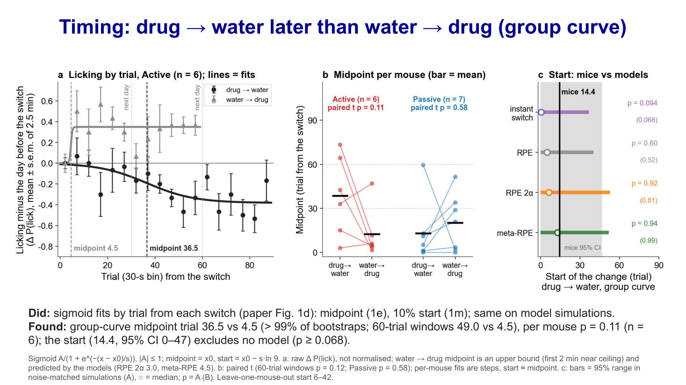
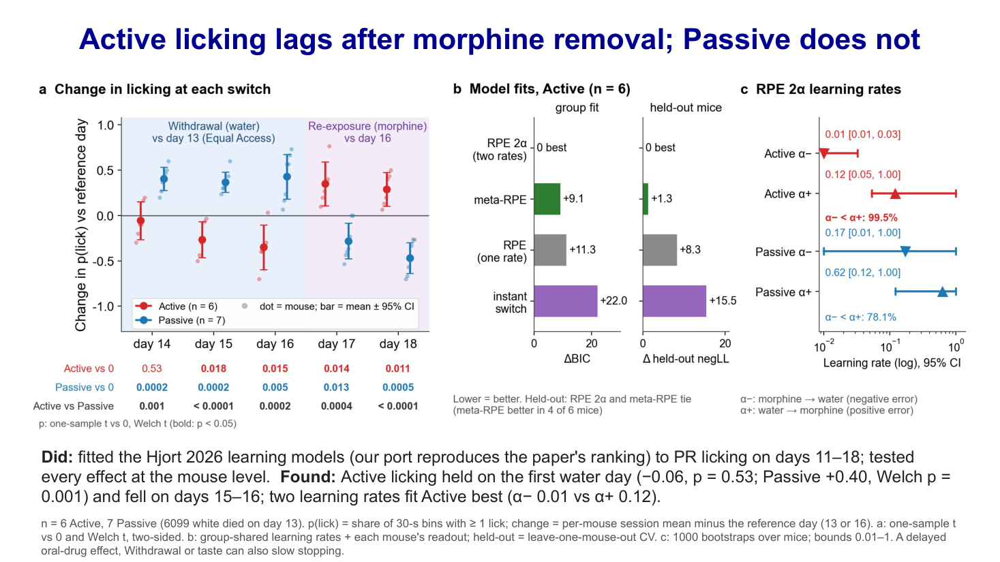
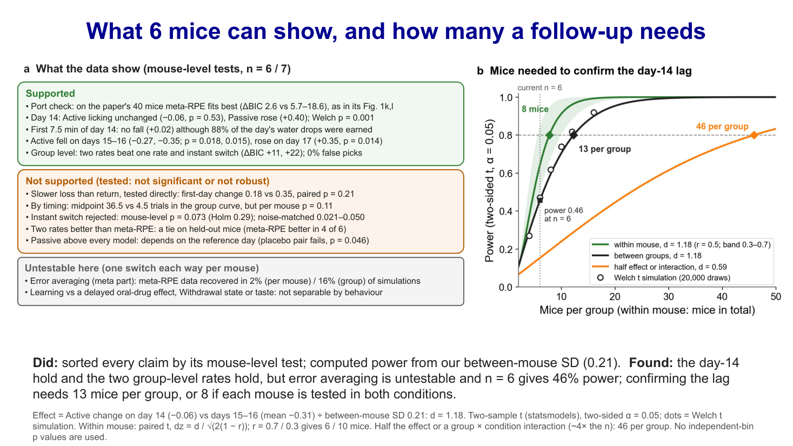

# 9. The current deck, slide by slide

CURRENT decks: `slides/mrpe_hjort2026_opioid_8slides_EN_v4_20261118.pptx` (English) and `slides/mrpe_hjort2026_opioid_8slides_KR_v4_20261118.pptx` (Korean slide text; full Korean explanation in the speaker notes; figures keep English labels). Slides 1-6 are byte-identical to the v2 6-slide decks of 17 Nov; slides 7-8 are the trial-by-trial v2 slides of 18 Nov.

Superseded, kept in the original project only: `*_6slides_*_20261117.pptx` (v1 of slides 1-6), `*_2slides_*_20261118.pptx` and `*_8slides_*_v3_20261118.pptx` (v1 of slides 7-8).

A separate 2-slide summary deck (2026-11-26), which condenses these results and adds a sample-size calculation, is described in the last section of this file.

Below, the English text of every slide is copied verbatim from the deck (title, KEY box, bottom line, footer, speaker notes). Preview images: `slides/preview_EN/slideN.png`; figure files: `slides/figures/`.

## Slide 1: Hjort et al. 2026: behaviour changes only after errors pile up



**KEY:** Meta-RPE delays the value drop by ~3 trials / Trials 0–2: meta-RPE 0.96, RPE 0.86, licking 1.03. Trials 3–5: both 0.72, licking 0.93.

**Bottom line:** Did: re-fitted the authors' 40 mice with their own code (ported to Python).  Found: the paper's ranking reproduces: meta-RPE fits best (ΔBIC 2.6 vs 5.7–18.6; better than each model, largest Holm p = 0.010).

**Footer (n and test):** Hjort et al., Nature 655:174 (2026), Fig. 1; code + data: github.com/stuberlab/Hjort-et-al.-2026-PFC-and-reversal-learning (H→L cue, 160 trials, reversal at trial 60). a: per mouse, trials 20–59 = 1, 120–159 = 0; mean ± SEM. b: step = α·δ·M, M = max(0, −CD) + max(0, CE). c: BIC = k ln T + 2 negLL; * paired t vs meta-RPE, Holm over 5 (paper: RM ANOVA + Holm–Šídák; same ranking, p values differ).

<details><summary>Speaker notes (verbatim)</summary>

```text
WHAT: Fig. 1 of Hjort et al. 2026 (Nature 655:174) redrawn from the authors' 40 sample mice with their own model code (BehaviorModels.ipynb, ported line by line to Python + numba; same equations, bounds, start grid and BIC).
TASK: head-fixed mice, 4 odour cues (2 at 85% sucrose, 2 at 15%). After stable licking, one unsignalled reversal: one 85% cue becomes 15% (H->L, contingency degradation) and one 15% cue becomes 85% (L->H, enhancement); the other two (H->H, L->L) are controls. Behaviour = anticipatory licks 0-2.5 s after cue onset. The model is fitted to the H->L cue: 160 trials (the authors' notebook: 4 days of 40 trials, reversal at trial 60).
a: licking stays high for ~6 trials. In trials 0-2 the RPE value is already 0.86 while the meta-RPE value is 0.96 (licking 1.03); by trials 3-5 both models are at 0.72 while licking is still 0.93. So meta-RPE delays the drop by ~3 trials, not as long as the mice.
b: the single-trial RPE is largest right after the reversal; the averaged error CD needs several trials to build, so the gain M peaks at trial 11. Learning step = alpha x delta x M; M rises when CD < 0 or CE > 0.
c: our port gives the paper's ranking (Fig. 1k,l): BIC change from best 2.6 (meta-RPE) vs 5.7-18.6; paired t vs meta-RPE with Holm correction, largest p = 0.010 (the paper used RM ANOVA + Holm-Sidak, so its p values differ); by negLL meta-RPE is best in 30/40 mice.
Rest of the paper: 13% of mPFC neurons encode CD (GLM + circular-shift null); holographic activation of CD cells reduces licking; mPFC dopamine carries RPE/CE signals; 61% of mPFC->VTA cells encode CD; D1/D2 block in mPFC lowers CD encoding and delays reversal; mPFC->VTA stimulation speeds degradation. The authors speculate that CD-encoding cells might be impaired after long-term voluntary drug taking.
```

</details>

**Note for this guide:** of the 'Rest of the paper' sentence in these notes, only the 13% (13.1 +- 1.1%) and 61% (61.5 +- 9.45%) figures and the speculation (the paper says 'extended volitional access to drugs of abuse') were re-checked against the paper text for this guide; the other neural statements were not re-verified. See docs/01.

## Slide 2: Same equations, different task: the model on our PR licking



**KEY:** Days 11–18: same drops for both groups on the same days, so both are compared at the same two switches.

**Bottom line:** Did: kept the paper's learning-rule equations and bounds; replaced the readout (logistic with intercept, time terms, β of either sign); redefined trial, choice and outcome.  Found: each mouse has one morphine → water and one water → morphine switch (240 bins); β > 0 in all 6 Active and β < 0 in all 7 Passive mice.

**Footer (n and test):** n = 6 Active, 8 Passive (7 after day 13: 6099 white died, left out of model comparisons). PR = progressive ratio (+1 lick per drop), ~15-min sessions. Passive days 6–10 = replay of the partner's drops (morphine drunk, licks earn nothing): drops update value, licking is not fitted. β < 0 = licks less when expecting morphine, so for Passive mice morphine → water is not a reward omission. Raw controller logs (K:, read only).

| | Hjort 2026 (Pavlovian) | Our task (PR licking) |
|---|---|---|
| Trial | cue every ~20 s | 30-s bin of the 15-min session |
| Choice | anticipatory lick: yes / no | any lick in the bin: yes / no |
| Outcome | sucrose 1 / none 0 (85% ↔ 15%) | each drop: morphine 1 / water 0 |
| Value Q | expected reward of the cue | expected drug from the spout; updated at every drop, from 0 on day 3 |
| Switch | one reversal: H→L, L→H | day 14 morphine → water; day 17 water → morphine |
| Fitted | 160 trials (4 days) per mouse | days 11–18: 240 bins per mouse |
| Readout | softmax(β·Q), β > 0 | logistic(b0 + β·Q + time + first 3 min); β of either sign |

<details><summary>Speaker notes (verbatim)</summary>

```text
WHAT: what had to change to use the paper's model on our data.
SAME: the learning-rule equations (RPE, meta-RPE, RPE 2alpha, RPE t-1, Pearce-Hall, eMack) and their parameter bounds, maximum-likelihood fitting and BIC.
CHANGED: (1) the task: the paper changes the reward PROBABILITY of a cue (Pavlovian); in our free-operant PR task every completed ratio gives a drop and its IDENTITY changes (morphine <-> water). So trial = 30-s bin, choice = any lick in the bin, outcome = drop identity (morphine 1, water 0). (2) the readout: the paper uses softmax(beta*Q) with beta > 0, start values 0.15 / 0.85 and updates only the chosen option; we use logistic(b0 + beta*Q + time in session + first 3 min) with beta of either sign, value 0 on day 3, updated at every drop (in an operant task a drop only follows licking).
VALUE Q = expected drug from the spout, carried over between days; Passive replay drops (days 6-10) update it too, but their replay-day licking is not fitted. Fitted days 11-18 (240 bins per mouse), where both groups run the same PR schedule with the same outcome sequence.
SIGN OF BETA: positive in all 6 Active mice, negative in all 7 Passive mice (per-mouse fits): Passive mice lick less when they expect morphine, so for them day 14 (morphine -> water) is relief rather than a reward omission, and the H->L analogy holds only for Active mice.
Right, bottom: one real session (0910 black, day 14): grey bins had at least one lick; triangles = water drops.
```

</details>

**Wording note:** the footer's 'morphine drunk' predates the 'earned / delivered' rule; consumption was not measured, so read it as 'morphine delivered' (docs/07 rule 1).

## Slide 3: First water day: Active licking holds, Passive licking rises



**KEY:** First water day: Active −0.06 (95% CI −0.27 to +0.15, n = 6) vs Passive +0.40 (n = 7); Welch t p = 0.001.

**Bottom line:** Did: compared each day with the last day before the switch (session means, within mice).  Found: Active fell only on days 15–16 (−0.27, −0.35; p = 0.018, p = 0.015) and rose on the first morphine day (+0.35, p = 0.014); Passive changed on the first day both ways (+0.40, −0.28).

**Footer (n and test):** p(lick) = share of 30-s bins with ≥ 1 lick; change = per-mouse session mean minus the reference day (13 or 16). n = 6 Active, 7 Passive (6099 white died on day 13). One-sample t vs 0 and Welch t (Active vs Passive), two-sided. Active, size of the first-day change, day 14 vs day 17: 0.18 vs 0.35, paired t p = 0.21: the asymmetry is not significant on its own. Drug action within the session and withdrawal can also give slow stopping and fast resumption.

<details><summary>Speaker notes (verbatim)</summary>

```text
WHAT: behaviour without any model. a: p(lick) per 3-min block of each 15-min PR session, days 11-18; light blue = water days. b: day 14 minus day 13 (morphine -> water); c: day 17 minus day 16 (water -> morphine), per 3-min block; the printed tests use whole-session means.
Day 14: Active −0.06 (95% CI −0.27 to +0.15, p = 0.53): no detectable change on the first water day; Passive +0.40 (p = 0.0002); Active vs Passive, Welch t p = 0.001.
Days 15-16 vs 13: Active −0.27 (p = 0.018) and −0.35 (p = 0.015): Active licking falls one day after the switch. Day 17: Active +0.35 (p = 0.014), Passive −0.28 (p = 0.013).
MEANING: Active mice changed one day late when morphine was removed but on the first day when it returned - the same direction as the paper's 'H->L slower than L->H'. Passive mice changed on the first day both ways (possibly taste: morphine is bitter; and beta < 0, so for them the valence is reversed).
CAVEATS: the direct test of the asymmetry in Active (size of the first-day change, 0.18 vs 0.35, p = 0.21, n = 6) is not significant. Drug action within the session (day 17) and a withdrawal state (day 14) could produce the same pattern; behaviour alone cannot separate these from learning.
```

</details>

## Slide 4: Active: slow updating after morphine loss fits best



**KEY:** Best fit (BIC and held-out mice): two learning rates, slow after morphine → water, fast after water → morphine.

**Bottom line:** Did: fitted 6 learning rules + 2 no-learning controls (learning rates shared within a group); BIC and leave-one-mouse-out CV.  Found: Active: two rates best (ΔBIC meta-RPE +9, one rate +11, instant switch +22; held-out negLL +1.3, +8.3, +15.5); Passive: learning rules ≈ instant switch (held-out ≤ 2.6).

**Footer (n and test):** Lines = mean model predictions; dots = observed mean ± SEM (3-min blocks). Readout logistic(b0 + β·Q + time + first 3 min) per mouse. BIC (n = 1440 / 1680 bins) treats bins as independent and overstates the evidence; held-out = learning rates fitted on the other mice. n = 6 Active, one switch each way; α− at its lower bound (0.01); withdrawal or drug action within the session can mimic the pattern. PH, no learning: ΔBIC ≥ 70.

<details><summary>Speaker notes (verbatim)</summary>

```text
WHAT: the learning rules fitted per group: learning rates shared by the mice of a group, readout (b0, beta, time terms) per mouse, solved exactly for every candidate learning rate. BIC with n = 1440 (Active) / 1680 (Passive) bins.
a: dots = observed, lines = mean model predictions. Orange (RPE 2alpha) and green (meta-RPE) fall slowly on day 14 and rise fast on day 17; dashed purple (today's outcome = switch at once) predicts day 14 far too low. b: in Passive all four model lines overlap.
c: dBIC. Active: RPE 2alpha 0, meta-RPE 9, RPE 11, RPE t-1 14, eMack 13, today's outcome 22. Passive: today's outcome 0, RPE 7, RPE t-1 9, RPE 2alpha 14, meta-RPE 20. Because 30-s bins are not independent, these dBIC values overstate the evidence.
HELD-OUT MICE (leave-one-mouse-out): Active total held-out negLL relative to RPE 2alpha: meta-RPE +1.3, RPE +8.3, today's outcome +15.5 (RPE 2alpha better than RPE in 5/6 held-out mice). Passive: every learning rule within 2.6 of today's outcome - indistinguishable.
GROUP-LEVEL RECOVERY (50 simulated sets per model): RPE 2alpha was picked in 0% of RPE-made and 0% of instant-switch-made sets, so its win is not a false positive of BIC; meta-RPE-made sets were called RPE 2alpha in 54% (meta-RPE itself 16%).
Parameters (Active): RPE 2alpha alpha- = 0.01 (lower bound), alpha+ = 0.12; meta-RPE alpha = 0.18, d = 0.01, e = 0.10 (both at the paper's bounds). meta-RPE also fits slightly worse (negLL 810.3 vs 809.3) with one parameter more.
MEANING: Active licking is best described by slow updating after morphine loss and fast updating after its return; whether errors are averaged (the meta part) cannot be told. Passive mice switch without a detectable learning lag. All Passive mice have beta < 0 (they lick less when expecting morphine).
```

</details>

## Slide 5: The data show the asymmetry but cannot test error averaging



**KEY:** meta-RPE made the data, yet per-mouse BIC found it in only 2% (Active) / 1% (Passive) of sets.

**Bottom line:** Did: refitted simulated licking per mouse (20 sets each) and per group (50 sets each); bootstrapped the group learning rates.  Found: meta-RPE is not recoverable (2% per mouse, 16% per group), but two rates are never picked for one-rate or instant-switch data (0%); Active α− 0.01 vs α+ 0.12 (α− < α+ in 99.5% of bootstraps).

**Footer (n and test):** a: each mouse's own fitted model + its real drop sequence; 3 models refitted; 6 + 7 mice x 20 sets. b: shared learning rates + each mouse's readout; 4 models refitted; 50 sets per model (Passive: sets made with learning are called 'instant switch' in 52–62%). c: point = all mice, bar = 95% CI of 1000 bootstraps over mice; bounds 0.01–1. A per-mouse test needs several switches per mouse (e.g. repeated morphine ↔ water, or 85% → 15% morphine drops).

<details><summary>Speaker notes (verbatim)</summary>

```text
WHAT: can these data tell the models apart, and how sure is the learning asymmetry?
a (per mouse, like the paper): from each mouse's fitted models we simulated 20 licking sets and refitted three models. When meta-RPE made the data, BIC picked meta-RPE in 2% (Active) / 1% (Passive) of sets; RPE-made sets were recognised in 43% / 24%, instant-switch sets in 99% / 98%. Per-mouse BIC leans to the simplest model, so 'meta-RPE lost' per mouse means nothing here.
b (group level, Active): RPE 2alpha-made sets were recovered in 56% (otherwise called RPE); RPE- and instant-switch-made sets were never called RPE 2alpha (0%); meta-RPE-made sets were recovered in only 16% (mostly called RPE 2alpha). Passive: sets made with learning were called instant switch in 52-62%, so the Passive 'instant switch' result does not exclude fast learning.
c: RPE 2alpha group fit, 1000 bootstraps over mice. Active alpha- 0.01 [0.01, 0.03] vs alpha+ 0.12 [0.05, 1.00]; alpha- < alpha+ in 99.5%. Passive alpha- 0.17 vs alpha+ 0.62, 78% (unclear).
MEANING: slow updating after morphine loss / fast after return is the robust part in Active mice; whether errors are averaged (the meta part) cannot be decided with this design. NEXT DESIGN: several switches per mouse, probabilistic outcomes (e.g. 85% -> 15% morphine drops) or a cue that signals morphine vs water.
```

</details>

## Slide 6: Model variables per drop: regressors for ORBm / BMAp neurons



**KEY:** If CD cells exist (paper: mPFC), meta-RPE predicts / Active: slow ramp; CD lowest after 54 of 68 water drops (days 14–16). / Passive: fast step; CD lowest 16 drops after the switch (β < 0: for them morphine → water is not an omission). / Test as in the paper: GLM with δ, CD, CE and Q per drop, circular-shift null.

**Bottom line:** Did: computed RPE δ, CD, CE, gain M and value Q at every drop with the group-fitted meta-RPE (one yoked pair shown).  Found: Active CD is lowest 54 drops after the switch, Passive after 16 (shared parameters: Active 45–54, Passive 16 across mice): a prediction, not a result.

**Footer (n and test):** Pair 4: Active 0910 black, Passive 0910 orange. meta-RPE lost the group comparison (ΔBIC +9 Active, +20 Passive); d = 0.01 and e = 0.10 sit at the paper's bounds and d is poorly recovered (r = 0.18), so the CD time course is a model assumption. Only a negative CD or a positive CE raises the gain M. Paper: CD cells in mPFC (prelimbic) and mPFC→VTA; ORBm and BMAp were not studied.

<details><summary>Speaker notes (verbatim)</summary>

```text
WHAT: the variables meta-RPE computes at every drop - what a neural GLM would use once ORBm / BMAp calcium imaging exists (as in the paper's Fig. 2, with a circular-shift null for p values).
a, c: black = value Q (expected drug), grey bars = RPE delta per drop; from day 14 the drops are water, so delta < 0.
b, d: red CD = slow running mean of errors, blue CE = fast running mean, green dashed = gain M (sets how much is learned). M rises when CD < 0 or CE > 0. CE also dips fast at the switch in both groups, but a negative CE does not raise M.
PREDICTION (only if meta-RPE is right): Active 0910 black: CD builds over days 14-16 and is lowest after 54 of 68 water drops -> a CD cell would ramp slowly. Passive 0910 orange: CD is lowest 16 drops after the switch -> a step. With shared group parameters the counts are nearly the same in every mouse (Active 45–54, Passive 16).
CAVEATS: meta-RPE lost the group comparison (dBIC +9 Active, +20 Passive); d and e sit at the paper's bounds (Active alpha = 0.18, d = 0.01, e = 0.10; Passive alpha = 3.29, d = 0.01, e = 0.10) and d is poorly recovered (r = 0.18). The winning RPE 2alpha model gives value Q and delta but no averaged error. Passive mice have beta < 0, so 'drug gone' is not an omission for them. The paper found CD cells in mPFC (prelimbic; 13% of cells) and among mPFC->VTA cells (61%); ORBm and BMAp were not studied.
```

</details>

## Slide 7: Day 14: no clear fall in licking in the first 7.5 min



**KEY:** By minute 7.5 the mice had earned 88% of the day's water drops, yet licking was unchanged (+0.02).

**Bottom line:** Did: compared each 30-s trial with the same trial on day 13 in mice and fitted models; tested per mouse.  Found: day-14 licking changed −0.06, less than all models predicted (by 0.05–0.17); only instant switch nears rejection (mouse p = 0.073, simulated 0.021–0.050); within day 14 vs overnight cannot be separated.

**Footer (n and test):** Trial = 30-s bin; Δ = any lick minus the same bin on day 13. n = 6 Active, 7 Passive. Models = group fits. c: dots = mice, ◆ = mean ± 95% CI, paired t. Noise-matched simulations, p: instant switch 0.021–0.050, RPE 0.078–0.14, RPE 2α 0.23–0.31, meta-RPE 0.52–0.59. First 2 min at ceiling. 95% CI: within −0.60 to +0.29, overnight −0.53 to +0.49. Passive day 14 +0.40.

<details><summary>Speaker notes (verbatim)</summary>

```text
WHAT: the paper's behavioural point is that mice do not change right after the reversal, when the errors are largest (the pattern it uses to explain Fig. 1h; the Fig. 1h correlation itself is not computed here). Same question for the drug -> water switch, trial by trial (30-s bins = the trials the models were fitted on).
a: drops are reward deliveries earned by licking (drinking was not measured). Active earned 28.3 water drops on day 14, 66% by 2.5 min and 88% by 7.5 min. This front-loading is the PR schedule (the ratio starts at 1 lick): on day 13 (morphine) 58% came by 2.5 min (dashed). Every model updates at each drop, so the models expect most of the day-14 change early.
b: P(lick) is 1.0 in the first 2 min on days 13 and 14 (ceiling), so a fall cannot show there. From 2.5 to 7.5 min licking was unchanged; one low block at 7.5-10 min (-0.30); the last 5 min were back to -0.07 / -0.03; day 15 was lower throughout.
c: mice minus model for the whole day-14 change, per mouse, paired t (n = 6): instant switch +0.169 (95% CI -0.02 to +0.36), p 0.073; RPE +0.134 (95% CI -0.07 to +0.34), p 0.15; RPE 2α +0.092 (95% CI -0.11 to +0.29), p 0.30; meta-RPE +0.052 (95% CI -0.17 to +0.27), p 0.58. Noise-matched simulations (two calibrations of day-to-day and within-session noise, fitted to days 11-13; range = calibration A, B): instant switch p 0.050, 0.021; RPE p 0.14, 0.078; RPE 2α p 0.31, 0.23; meta-RPE p 0.59, 0.52. The v1 check with independent bins gave p < 0.001 for instant switch but was too narrow: it rejected a no-change placebo (Passive day 12 -> 13, p < 0.001). Not on the slide: eMack and no learning also pass day 14; no learning fails days 15-16.
Within vs overnight: within day 14 -0.156 (95% CI -0.60 to +0.29), overnight -0.022 (-0.53 to +0.49); the two are near mirror images across mice, and 5-min windows split the change equally (-0.083 / -0.083). This design cannot place the fall.
Passive: licking rose at once on day 14 (+0.40, first half +0.31), more than every model predicted (mouse-level p 0.005 for RPE 2alpha); likely taste (beta < 0).
MEANING: descriptively, the fall came after most water drops (the paper's pattern), but with 6 mice and one switch no model is rejected, and a delayed oral drug effect would give the same lag. Noise model details: m15 (e.g. RPE 2alpha calibration A: sd 1.0 per day, 3.0 within session, phi 0.7).
```

</details>

**Caveat added 2026-11-19 (not in the deck):** the Passive sentence in these notes ('more than every model predicted ... mouse-level p 0.005') depends on an unusually low reference day 13; the Passive placebo pair (day 13 minus day 12, -0.19) also fails the mouse-level test (p = 0.046). Measured from day 12 the Passive rise is +0.22, smaller than predicted. See docs/05 section 5.3.

## Slide 8: Timing: drug → water later than water → drug (group curve)



**Bottom line:** Did: sigmoid fits by trial from each switch (paper Fig. 1d): midpoint (1e), 10% start (1m); same on model simulations.  Found: group-curve midpoint trial 36.5 vs 4.5 (> 99% of bootstraps; 60-trial windows 49.0 vs 4.5), per mouse p = 0.11 (n = 6); the start (14.4, 95% CI 0–47) excludes no model (p ≥ 0.068).

**Footer (n and test):** Sigmoid A/(1 + e^(−(x − x0)/s)), |A| ≤ 1; midpoint = x0, start = x0 − s·ln 9. a: raw Δ P(lick), not normalised; water → drug midpoint is an upper bound (first 2 min near ceiling) and predicted by the models (RPE 2α 3.0, meta-RPE 4.5). b: paired t (60-trial windows p = 0.12; Passive p = 0.58); per-mouse fits are steps, start ≈ midpoint. c: bars = 95% range in noise-matched simulations (A), ○ = median; p = A (B). Leave-one-mouse-out start 6–42.

<details><summary>Speaker notes (verbatim)</summary>

```text
WHAT: the paper's Fig. 1d,e,m on our trials. d: a sigmoid fitted to licking across trials from the reversal; e: its midpoint per mouse (H->L later than L->H, P = 0.027, n = 20, both cues reversed in the same session); m: the trial where the change starts, compared with each model's value curve (only meta-RPE was not significantly different, P = 0.21, n = 40).
a: Active group-mean curves, raw change in P(lick) against the day before the switch (not normalised; the paper's Fig. 1d is normalised and smoothed). Drug -> water midpoint trial 36.5 (95% CI 13.5-68.0; trial 30 = start of day 15), water -> drug 4.5 (3.5-15.0). Drug -> water was later in 99.7% of 2000 bootstraps over mice (a share, not a p value). Windows differ (90 vs 60 trials); with equal 60-trial windows the drug -> water midpoint is 49.0 (the fit is flat for midpoints about 28-50). Leave-one-out midpoints 31.5-44.0 vs 4.0-4.5: the direction is robust. The water -> drug midpoint is an upper bound (licking near ceiling in the first 2 min) and every model predicts it.
b: per mouse, the paper's test. Active drug -> water 42.5, 33.0, 15.0, 64.5, 73.5, 3.0; water -> drug 1.5, 47.0, 4.5, 4.0, 11.5, 6.0 (paired t p 0.11, Wilcoxon p 0.22, 4/6 later; equal windows p 0.12). Passive 12.9 vs 20.1 (p 0.58): at once at drug -> water; the water -> drug change is gradual (group fit at its amplitude bound). Per-mouse fits are steps (s at its 0.3-trial floor), so a mouse's start is its midpoint minus 0.66.
c: start of the drug -> water change in the group curve vs simulated data from each fitted model with noise matched to days 11-13 (calibration A; B in brackets): instant switch median 0.3, 95% range 0.0-36.9, p 0.094 (0.068); RPE median 4.8, 95% range 0.0-40.4, p 0.60 (0.52); RPE 2α median 6.2, 95% range 0.0-52.9, p 0.92 (0.81); meta-RPE median 12.8, 95% range 0.0-51.8, p 0.94 (0.99). Midpoint, same check: instant switch p 0.069 (0.047); RPE p 0.30 (0.22); RPE 2α p 0.87 (0.84); meta-RPE p 0.93 (0.95). The mice's own start is uncertain: 95% CI 0-47, leave-one-out 6.4-41.8.
MEANING: at the group level the drug -> water change is later than the water -> drug change (as in the paper), but the paper's per-mouse test is not significant here (n = 6), and the start does not separate the models. Our two switches are 3 days apart with different histories (8 drug days vs 3 water days), unlike the paper's single session. The fast water -> drug change happened within ~2.5 min, before an oral dose acts; taste may act as a learned drug cue (not tested).
```

</details>

## Summary deck: 2 slides (added 2026-11-26)

Files: `slides/summary_20261126/mrpe_summary_2slides_EN_20261126.pptx` (English) and `slides/summary_20261126/mrpe_summary_2slides_KR_20261126.pptx` (Korean slide text and speaker notes; figures keep English labels). PDF renders: `slides/summary_20261126/preview_EN/mrpe_summary_2slides_EN_20261126.pdf` and `slides/summary_20261126/preview_KR/mrpe_summary_2slides_KR_20261126.pdf`; figure files: `slides/summary_20261126/figs/`.

Made by `project/m17_make_summary_2slides.py` from the result files in `project/data/` (no new model fits). It condenses slides 3-5 and 7-8 and docs/04-06, and adds one new analysis: the sample-size (power) calculation on slide 2 (README item 13). Its 100 number checks and 20 text-fit checks pass (`slides/summary_20261126/fit_report.json`).

As above, the English text is copied verbatim from the deck.

### Summary slide 1: Active licking lags after morphine removal; Passive does not



**Bottom line:** Did: fitted the Hjort 2026 learning models (our port reproduces the paper's ranking) to PR licking on days 11–18; tested every effect at the mouse level.  Found: Active licking held on the first water day (−0.06, p = 0.53; Passive +0.40, Welch p = 0.001) and fell on days 15–16; two learning rates fit Active best (α− 0.01 vs α+ 0.12).

**Footer (n and test):** n = 6 Active, 7 Passive (6099 white died on day 13). p(lick) = share of 30-s bins with ≥ 1 lick; change = per-mouse session mean minus the reference day (13 or 16). a: one-sample t vs 0 and Welch t, two-sided. b: group-shared learning rates + each mouse's readout; held-out = leave-one-mouse-out CV. c: 1000 bootstraps over mice; bounds 0.01–1. A delayed oral-drug effect, Withdrawal or taste can also slow stopping.

<details><summary>Speaker notes (verbatim)</summary>

```text
WHAT: the behaviour and model results on one slide (details: slides 3-5 and 7-8 of the 8-slide v4 deck).
a: per-mouse change in p(lick) (share of 30-s bins with at least one lick) from the last day before each switch. Days 14-16 (Withdrawal, water) are compared with day 13 (Equal Access, morphine); days 17-18 (Re-exposure, morphine) with day 16. Active licking did not change on day 14 (−0.06, p = 0.53) and fell on days 15-16 (−0.27, −0.35); it rose again on day 17 (+0.35, p = 0.014). Passive licking rose on day 14 already (+0.40). Rows under the axis: one-sample t vs 0 per group and Welch t between groups.
b: group fits to Active licking on days 11-18 (learning rates shared by the group, each mouse's own readout). RPE 2alpha (separate rates after negative and positive errors) is best by BIC (meta-RPE +9.1, RPE +11.3, instant switch +22.0). On held-out mice (leave-one-mouse-out) RPE 2alpha and meta-RPE tie (+1.3; meta-RPE better in 4 of 6 mice); one rate (+8.3) and the instant switch (+15.5) are worse.
c: RPE 2alpha rates with 95% CIs from 1000 bootstraps over mice. Active: alpha- 0.01 [0.01, 0.03] vs alpha+ 0.12 [0.05, 1.00]; alpha- < alpha+ in 99.5% of bootstraps. Passive rates are wide (78.1%).
CAVEATS: one switch each way per mouse, n = 6 / 7. Oral morphine acts minutes after a drop, so a delayed drug effect, the Withdrawal state or taste could produce the same lag. Port check: on the authors' 40 mice our Python port gives the paper's ranking (meta-RPE BIC change from best 2.6 vs 5.7-18.6).
```

</details>

### Summary slide 2: What 6 mice can show, and how many a follow-up needs



**Left column:** a  What the data show (mouse-level tests, n = 6 / 7)

- **Supported**
  - Port check: on the paper's 40 mice meta-RPE fits best (ΔBIC 2.6 vs 5.7–18.6), as in its Fig. 1k,l
  - Day 14: Active licking unchanged (−0.06, p = 0.53), Passive rose (+0.40); Welch p = 0.001
  - First 7.5 min of day 14: no fall (+0.02) although 88% of the day's water drops were earned
  - Active fell on days 15–16 (−0.27, −0.35; p = 0.018, 0.015), rose on day 17 (+0.35, p = 0.014)
  - Group level: two rates beat one rate and instant switch (ΔBIC +11, +22); 0% false picks
- **Not supported (tested: not significant or not robust)**
  - Slower loss than return, tested directly: first-day change 0.18 vs 0.35, paired p = 0.21
  - By timing: midpoint 36.5 vs 4.5 trials in the group curve, but per mouse p = 0.11
  - Instant switch rejected: mouse-level p = 0.073 (Holm 0.29); noise-matched 0.021–0.050
  - Two rates better than meta-RPE: a tie on held-out mice (meta-RPE better in 4 of 6)
  - Passive above every model: depends on the reference day (placebo pair fails, p = 0.046)
- **Untestable here (one switch each way per mouse)**
  - Error averaging (meta part): meta-RPE data recovered in 2% (per mouse) / 16% (group) of simulations
  - Learning vs a delayed oral-drug effect, Withdrawal state or taste: not separable by behaviour

**Bottom line:** Did: sorted every claim by its mouse-level test; computed power from our between-mouse SD (0.21).  Found: the day-14 hold and the two group-level rates hold, but error averaging is untestable and n = 6 gives 46% power; confirming the lag needs 13 mice per group, or 8 if each mouse is tested in both conditions.

**Footer (n and test):** Effect = Active change on day 14 (−0.06) vs days 15–16 (mean −0.31) ÷ between-mouse SD 0.21: d = 1.18. Two-sample t (statsmodels), two-sided α = 0.05; dots = Welch t simulation. Within mouse: paired t, dz = d / √(2(1 − r)); r = 0.7 / 0.3 gives 6 / 10 mice. Half the effect or a group × condition interaction (~4× the n): 46 per group. No independent-bin p values are used.

<details><summary>Speaker notes (verbatim)</summary>

```text
WHAT: every claim with the label it earned in the checks (claims table: teaching package docs/06), and the sample size a follow-up cohort needs.
SUPPORTED: the port reproduces the paper's ranking on its 40 mice; day 14: Active licking unchanged (-0.06, p = 0.53) while Passive rose (+0.40); the first 7.5 min of day 14 did not fall (+0.02) although 88% of that day's drops had been earned (PR front-loads drops); Active fell on days 15-16 and rose on day 17; at group level two rates beat one rate and the instant switch, and two rates are never picked for data made with one rate or the instant switch.
NOT SUPPORTED: the asymmetry as a direct test (0.18 vs 0.35, paired t p = 0.21); the later group-curve midpoint after drug loss (36.5 vs 4.5 trials) is not significant per mouse (p = 0.11); the instant switch is not rejected at the mouse level (p = 0.073, Holm 0.29; noise-matched simulations 0.021-0.050); RPE 2alpha vs meta-RPE is a tie on held-out mice; 'Passive rose more than every model' depends on the unusually low day-13 reference (placebo day 13 - 12 fails, p = 0.046).
UNTESTABLE: error averaging: data made by meta-RPE are recovered in 2% (per mouse) / 16% (group) of simulations, because each mouse has one switch each way; a delayed oral-drug effect, the Withdrawal state and taste cannot be separated from learning with behaviour alone.
POWER (statsmodels; inputs from our data only): between-mouse SD of the change in p(lick) = 0.21 (mean of 4 SDs recovered from the 95% CIs). Effect = the day-14 lag in Active mice: day-14 change -0.06 vs mean of days 15-16 -0.31 -> d = 1.18. Two-sample t, two-sided alpha 0.05: 12.3 per group for 80% (16.1 for 90%); power at n = 6 = 0.46; the Welch simulation (20,000 draws) agrees: n = 12 gives 0.82. Within mouse (each mouse tested in both conditions; paired t, dz = d / sqrt(2(1 - r))): 80% at 10.0 / 7.7 / 5.6 mice for r = 0.3 / 0.5 / 0.7 (power at n = 6 with r = 0.5: 0.64). Half the effect, or a group x condition interaction (about 4x the n): 46 per group or cell.
```

</details>
